# System Architecture
## AI-Based Real-Time Stress and Trauma Assessment Module (SIH26093)

> Companion documents: `PRODUCT_VISION.md` (what the product is: a plug-in module), `REQUIREMENTS.md` (what), `DATABASE.md` + `models.ts` (data), `API_CONTRACTS.md` (interfaces).
> Requirement IDs (FR-…, NFR-…, C-…) refer to `REQUIREMENTS.md`.

---

## Contents
1. [Architectural goals and key decisions](#1-architectural-goals-and-key-decisions)
2. [System context](#2-system-context)
3. [Containers (deployable parts)](#3-containers-deployable-parts)
4. [Components inside the web app](#4-components-inside-the-web-app)
5. [The assessment pipeline](#5-the-assessment-pipeline)
6. [Key flows (sequence diagrams)](#6-key-flows-sequence-diagrams)
7. [Analysis service (AI)](#7-analysis-service-ai)
8. [Scoring engine](#8-scoring-engine)
9. [Security and privacy architecture](#9-security-and-privacy-architecture)
10. [Real-time, jobs and failure handling](#10-real-time-jobs-and-failure-handling)
11. [Deployment](#11-deployment)
12. [Tech stack](#12-tech-stack)
13. [Repository structure](#13-repository-structure)
14. [Requirements coverage](#14-requirements-coverage)

---

## 1. Architectural goals and key decisions

| Goal | Comes from | How the architecture achieves it |
|---|---|---|
| Safety-critical detection never depends on one AI model | NFR-ETH-05, NFR-REL-01, FR-NLP-10 | **Two independent detection paths**: a fast rule-based *safety lexicon* inside the web app, plus ML/LLM analysis in a separate service. Either one alone can raise Critical. |
| Explainable, reproducible scores | NFR-ETH-03, FR-SVI-07 | The **scoring engine is a pure, deterministic TypeScript module** with versioned configuration. AI only produces *indicators with evidence*; the score is computed by transparent rules. |
| Real time | NFR-PERF-01…03 | Synchronous analysis per message (≤ 3 s budget), 5-second voice windows, push updates over WebSockets (Pusher). |
| Privacy by design | NFR-PRI-*, C-ETH-02 | PII vault separated from assessments; field-level encryption; role-based field filtering on the server; PII redaction before any third-party AI call; raw audio never stored by default. |
| Human in the loop | NFR-ETH-01 | AI writes *proposals* (indicators, recommendations). Only humans approve referrals or lower a band. |
| Swappable AI | NFR-MNT-01 | All AI sits behind one internal HTTP contract (`/v1/analyze/*`), so models can change without touching the web app. |
| Achievable as a coursework project | C-TEC-*, C-PRJ-* | One Next.js app + one Python service + MongoDB Atlas + Pusher. Every external piece has a free tier and a local fallback. |

### Key decisions (ADR summary)
| # | Decision | Alternatives considered | Why |
|---|---|---|---|
| ADR-1 | **Next.js (App Router) monolith** for the integration API, the staff portals and the public Nivara portal (since Phase P the portal journey) | Separate React SPA + Express API | One codebase and one deploy; route handlers are enough for the API; server components keep sensitive data on the server. |
| ADR-2 | **Separate Python FastAPI "analysis service"** for STT, acoustics, emotion and NLP | Doing everything in Node | The audio/ML ecosystem (Praat/parselmouth, librosa, Whisper, Hugging Face) is Python-first. |
| ADR-3 | **The module never talks to the person.** NHAA's chatbot or operator holds the conversation; the module only analyses it. Text it returns for the person (emergency options) and questions it suggests to operators are scripted and pre-translated | An LLM chatbot that talks to the victim; a built-in questionnaire | Safety and predictability: a generative bot could say something harmful to a traumatised person. LLMs are used only for *analysis*. |
| ADR-4 | **The AI outputs indicators; deterministic rules output SVI, bands and recommendations** | End-to-end model predicting the band | Explainability, auditability, tunable thresholds, and it works even when the model is down. |
| ADR-5 | **MongoDB (Atlas, replica set) + Mongoose** | PostgreSQL + Prisma | Team choice and familiarity; flexible documents suit variable AI outputs (indicators, voice features); TTL indexes give automatic retention; Atlas free tier is a replica set, so multi-document transactions work. Relations are handled by embedding bounded data and referencing unbounded data (see `DATABASE.md`). |
| ADR-6 | **Pusher Channels for real-time** (SSE fallback locally) | Self-hosted WebSocket server | Vercel serverless functions cannot hold long-lived sockets; Pusher's private channels give per-role authorisation. |
| ADR-7 | **DB-backed `jobs` collection, run inside normal requests** (no separate worker) for escalations, retention purges and follow-ups | Separate worker process; Redis/BullMQ | Free hosting has no always-on background workers (see `TOOLS_AND_COSTS.md`). Staff dashboards already poll every 10 s, which is often enough for a 2-minute escalation timer. |
| ADR-9 | **Free-tier AI stack**: Groq (LLM + Whisper), self-hosted IndicConformer for regional speech, analysis service on a team laptop behind a Cloudflare Quick Tunnel | Paid APIs; cloud GPU hosting | Coursework budget is ₹0; every choice was verified free on 14 Nov 2026 (`TOOLS_AND_COSTS.md`). The analysis-service interface stays the same, so production can move to government cloud without app changes. |
| ADR-8 | **Application-level field encryption** (AES-256-GCM) for message text, summaries, notes and PII | Relying only on disk encryption | Protects data even from someone with database read access (backups, dumps, admins). |
| ADR-10 | **A plug-in module with two inputs** (text messages, voice audio) behind one integration API; no victim website, no questionnaire, no structured answers (decided 16 Nov 2026, `PRODUCT_VISION.md` §5) | A victim portal with a scripted question flow and screeners | NHAA already has channels; a second front end for victims would duplicate them. Answers to questions asked by NHAA's chatbot or operator arrive as ordinary words. Trade-off: risk that is never put into words is not detected, and short answers need their question as context (FR-NLP-11). |

---

## 2. System context

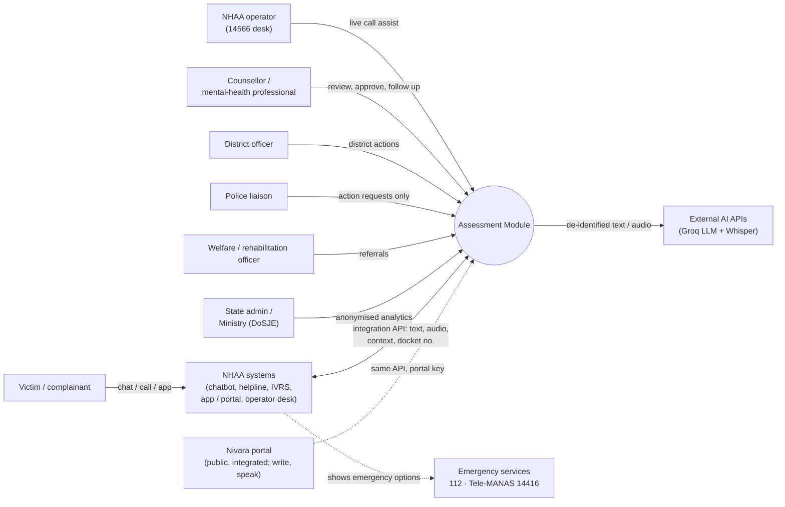

---

## 3. Containers (deployable parts)

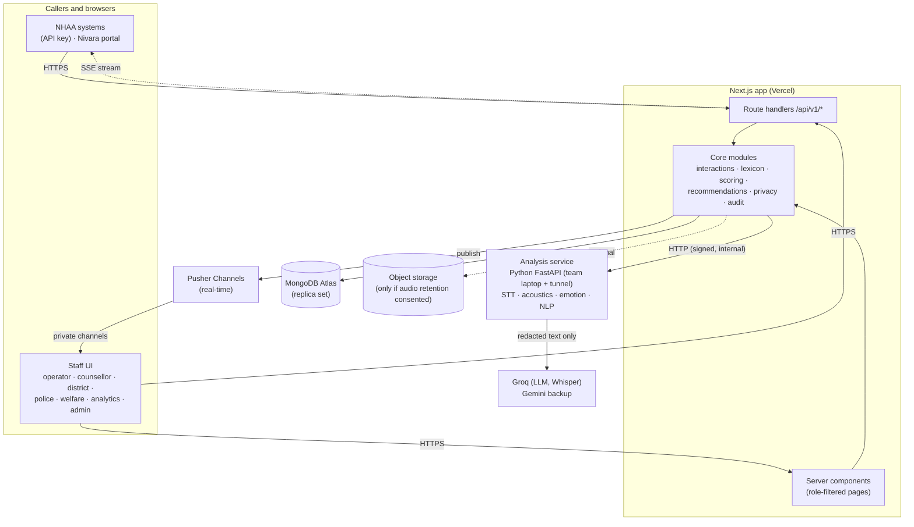

| Container | Responsibility | Technology | Scales by |
|---|---|---|---|
| **Calling systems** | NHAA's chatbot, helpline, IVRS, app or operator desk: own the person's interface and consent, call the integration API, show the returned emergency options. Not part of this repository. The public **Nivara portal** is one of them, built into this repository: since Phase P a portal journey with two inputs (write, speak), §6.6. | Any HTTP client with an API key | Outside the module |
| **Staff UI** | Role-specific dashboards, live updates, approvals | Next.js server components + client islands, `pusher-js` | Static + CDN |
| **API (route handlers)** | Integration API (API keys, the module's only input), staff API (Auth.js) | Next.js route handlers, Zod validation | Serverless instances |
| **Core modules** | Interactions (start, consent, end), safety lexicon, scoring, recommendations, RBAC, privacy, audit | TypeScript libraries inside the Next app | With the API |
| **Analysis service** (team laptop, exposed via Cloudflare Quick Tunnel for the deployed portal) | STT, language ID, translation, acoustic features, speech emotion, text NLP (indicators + evidence), summaries | Python, FastAPI, Groq (LLM + Whisper), IndicConformer, Silero VAD, parselmouth, librosa, emotion2vec+; Silero VAD, Hugging Face, LLM API | Horizontal (stateless) |
| **Job runner** (inside the web app) | Alert escalation timers, follow-up reminders, retention purges, re-scoring after config changes | `core/jobs/runDue()` called from dashboard polling and a protected internal route; no separate process | Atomic claim with `findOneAndUpdate` + `lockedUntil`, so concurrent requests never run a job twice |
| **MongoDB** | All persistent data | MongoDB 8 (Atlas), Mongoose 9 | Managed (Atlas M0 for now, M10+ for production) |
| **Pusher** | Push events to staff dashboards (calling systems use the integration SSE stream) | Pusher Channels (private/presence channels) | Managed |
| **Object storage** | Encrypted audio, only with explicit consent | S3-compatible (Supabase Storage / R2) | Managed |

---

## 4. Components inside the web app

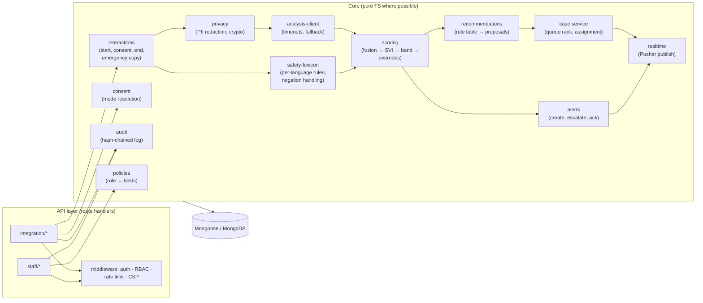

| Component | Key responsibilities | Requirements |
|---|---|---|
| `interactions` | Starts an interaction with the caller's consent state, records consent changes and withdrawal, ends it, writes the case summary, and builds the emergency options in the interaction's language. No question flow: the module never decides what to ask. | FR-CH-01/02/07/10, FR-CON-*, FR-REC-06 |
| `operator` | Suggests scripted, pre-translated questions for the operator to ask aloud (safety first, then what the evidence points at). Suggestions only; answers arrive as speech. | FR-DSH-01, ADR-3 |
| `consent` | Turns consent choices into an `AssessmentMode` (SAFETY_ONLY / TEXT_ONLY / VOICE_ONLY / FULL); every analysis call checks the mode first. | FR-CON-* |
| `safety-lexicon` | Per-language JSON rules (keywords, regexes, Hinglish spellings) for suicidal ideation, immediate danger and threats; negation window; runs in < 50 ms in-process. | FR-NLP-10, NFR-PERF-04, AC-NLP-06 |
| `privacy` | `redact()` for phone numbers, Aadhaar-like numbers, emails, addresses and names (from context + NER hints from the analysis service); `encrypt()`/`decrypt()` AES-256-GCM with key versioning. | NFR-SEC-05, NFR-PRI-* |
| `analysis-client` | Typed client for the analysis service; 2.5 s timeout for text, 4 s for audio; circuit breaker; on failure returns `{degraded: true}` so scoring runs in fallback mode. | NFR-REL-01/02 |
| `scoring` | Pure functions `fuseDimensions()`, `computeSvi()`, `assignBand()`, `applyOverrides()`, `explain()`; input = indicators (text NLP, lexicon, voice) + context + config; output = immutable `Assessment`. | FR-IND-03, FR-SVI-*, FR-RISK-* |
| `recommendations` | Evaluates the rule table (Appendix C) against the latest assessment; creates / supersedes `Recommendation` documents; auto-triggers EMERGENCY_SUPPORT for Critical. | FR-REC-* |
| `case` | Computes queue rank (`bandRank`, `currentSvi`, `waitingSince`); auto-assigns a counsellor by language + district + workload. | FR-CASE-* |
| `alerts` | Creates alerts on band rises; schedules `alert.escalate` jobs; handles acknowledgement. | FR-ALR-* |
| `policies` | Single source of truth for what each role may read or write; serialisers strip fields per role (e.g. police never get narrative or SVI breakdown). | NFR-PRI-02, FR-DSH-04, AC-DSH-01 |
| `audit` | `audit.record(actor, action, entity, meta)` inside the same DB transaction; hash chain. | FR-AUD-* |

---

## 5. The assessment pipeline

Every new signal (a message from the person, a 5-second voice window, a case-context update or a human review) runs through the same pipeline. Messages from NHAA's chatbot or operator (`sender: OPERATOR`) are stored as context only and never scored (FR-CH-02). Audio that holds both voices is scored as limited confidence until speaker separation exists (FR-VOI-10).

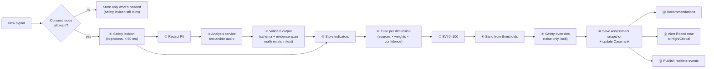

**Latency budget for one text message (target ≤ 3 s, NFR-PERF-01):**

| Step | Budget |
|---|---|
| Auth, consent check, store message | 150 ms |
| Safety lexicon | 50 ms |
| Redaction | 30 ms |
| Analysis service (LLM indicators + emotion + language ID + translation, in parallel) | 2,000 ms (timeout 2,500 ms) |
| Validation, fusion, SVI, overrides, DB writes (one transaction) | 250 ms |
| Recommendations, alert, publish | 200 ms |
| **Total** | **≈ 2.7 s** |

If the analysis service times out, steps ⑥–⑬ still run using lexicon + context signals only, and the assessment is marked `limitedConfidence = true`. A `rescore` job retries the analysis later and creates a new snapshot.

---

## 6. Key flows (sequence diagrams)

### 6.1 Text message (NHAA chatbot)
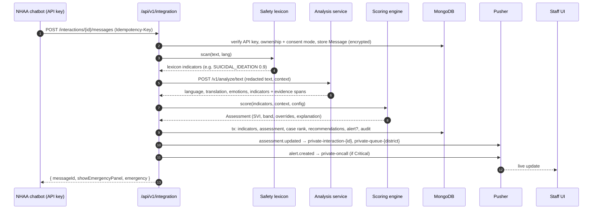
The `/messages` response carries no SVI, band or indicator names: only whether to show emergency options, and their text in the interaction's language, for the chatbot to show the person (NFR-ETH-02). Authorised callers read the assessment separately (`GET …/assessment`, scope `assessments:read`). A chatbot question such as "Are you safe right now?" is sent as `sender: OPERATOR`; it is stored as context for the next reply (FR-NLP-11) and not scored.

### 6.2 Voice: helpline call with operator assist
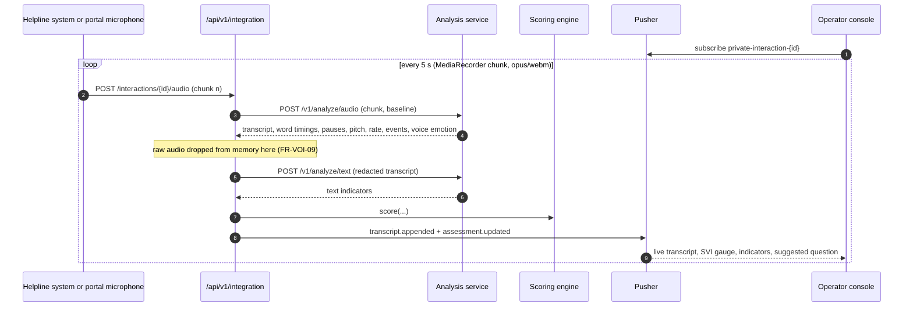
Budget per window: ≤ 5 s after the window ends (NFR-PERF-02). The first 20–30 s set the speaker's baseline (`Interaction.voiceBaseline`), and later windows are compared to it (FR-VOI-03). The caller's channel should be sent on its own (`audioSource: CALLER_ONLY`; call centres usually record agent and caller separately). For two-voice audio (`MIXED`, the default) the analysis service separates the speakers (FR-VOI-10, task M.10): Silero VAD finds the speech, CAM++ (via FunASR) gives each stretch a voice fingerprint, and the fingerprints are matched across the call (first speaker = operator unless `firstSpeaker` says otherwise). The caller's words go through scoring and the caller's speech gives the voice features; the operator's words become an `OPERATOR` turn. The two fingerprints round-trip encrypted through the web app (`interactions.speakerStateEnc`, deleted at the end). If separation is not confident, the interaction's assessments are limited confidence.

### 6.3 Critical: alert, emergency panel, escalation
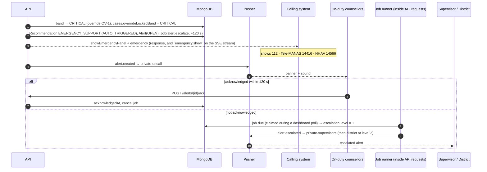

### 6.4 Recommendation approval → referral (police view stays minimal)
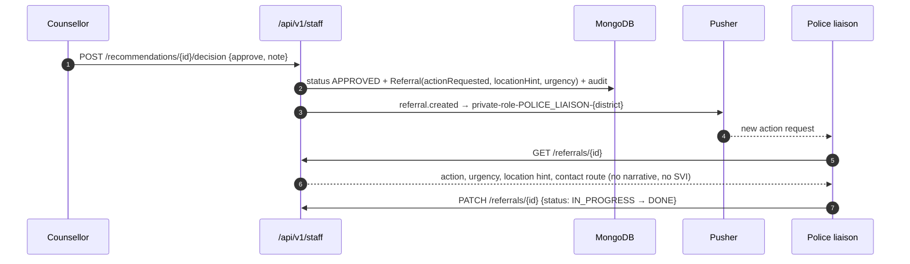

### 6.5 Consent withdrawal mid-session
1. The calling system sends `POST /api/v1/integration/interactions/{id}/consent/withdraw` → a `WITHDRAWN` entry is pushed to `interactions.consents`; `interactions.mode = SAFETY_ONLY`.
2. Any in-flight analysis results that arrive after this are discarded (checked against the mode at write time).
3. `stored_audio` documents are deleted and objects removed; a `retention.purge` job double-checks.
4. The complaint itself (docket and context) stays, so redressal continues (FR-CON-03/04).

### 6.6 portal: the portal journey (Phase P)

The public site is the **Nivara portal** (`NIVARA_FLOW_AND_UI_PLAN.md` §5–§8), integrated with the module like any NHAA channel: it reaches the module only through `/api/portal/*` → the integration API with the portal key, and the module runs and is tested with it switched off (FR-API-05). Two inputs, chosen once: **Write** (`/start/write`, channel `CHATBOT`) and **Speak** (`/start/speak`, channel `VOICE_CALL`, live microphone, `CALLER_ONLY` windows). No recordings.

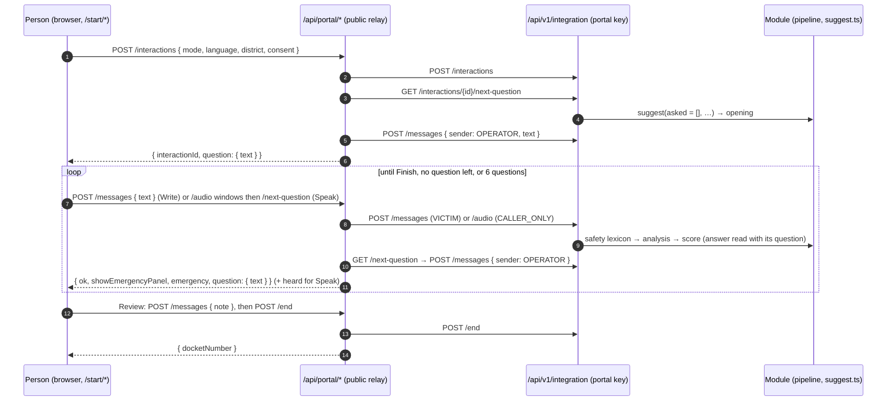

- **Only the server records `OPERATOR` turns**, and only scripted questions the module returned; the public message body has no `sender` (FR-PORTAL-04).
- The next question comes from the same pure rules as the operator console (`core/operator/suggest.ts`), extended with the keys already asked (FR-API-07). The AI never writes or says anything to the person (rule 2).
- The page shows the assistant's questions, the person's own words ("We heard: …" for Speak, and the Review step), the emergency options when raised, and the docket ID. Never a score, band or indicator (rule 1).
- Safeguards (`core/portal/guard.ts`, `public.ts`, `limits.ts`): kill switch, same-site, per-visitor and daily limits, the `nivara_portal` own-cases cookie, per-case caps (40 messages, 6 questions, 3 min of speech, 15 min in all), one live call at a time, freed after 60 s with no activity.
- **Languages (FR-LANG-07):** the site language lives in the `NEXT_LOCALE` cookie (no URL prefix), read by `next-intl` (`src/i18n/request.ts`, `NextIntlClientProvider` in `app/layout.tsx`). It switches the public pages, login and staff portals, and becomes the interaction's `language` when the interaction is created. `core/i18n/messages.ts` keeps serving the module's own server-side text.

---

## 7. Analysis service (AI)

A stateless Python service. The web app is its only client (authenticated with an HMAC-signed header). It never writes to the database.

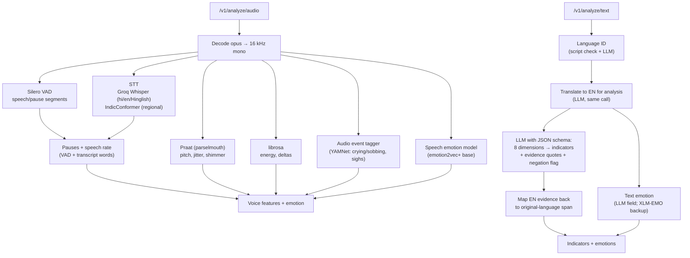

| Function | Primary option | Fallback / low-cost option |
|---|---|---|
| Speech-to-text | Groq `whisper-large-v3-turbo` for Hindi, English, Hinglish; AI4Bharat IndicConformer-600M (self-hosted) for Marathi, Tamil, Bengali | Bhashini ASR API (free, proof-of-concept use); typing or keypad if all fail |
| Pauses | Silero VAD on the raw audio | Energy-threshold VAD (librosa) |
| Pitch, jitter, shimmer | parselmouth (Praat) | librosa `pyin` |
| Speech emotion | emotion2vec+ base (FunASR) | Rule-based mapping from pitch/energy deviation (low weight) |
| Crying, sobbing, sighs | YAMNet audio event classes | Off (feature optional, FR-VOI-05 is "Should") |
| Language ID | Unicode script detection + LLM (in the indicator call) | User's chosen language |
| Translation | LLM (same call as indicators) | IndicTrans2 self-hosted (optional) |
| Indicators | Groq `openai/gpt-oss-120b` (dev: `gpt-oss-20b`) with strict JSON schema output and a compact few-shot prompt | Gemini Flash free tier on rate-limit; safety lexicon only (in the web app) if both fail |
| Text emotion | LLM emotion field | XLM-EMO (4 classes) |

**Guardrails on AI output (validated in the web app, step ④):**
- The response must match the Zod schema exactly; otherwise it is discarded and the call counts as failed.
- Each `evidence.quote` must be found word-for-word in the original message, otherwise that indicator is dropped (AC-NLP-05).
- Scores are clamped to 0–1, and unknown dimensions are rejected.
- The LLM prompt forbids diagnosis wording and asks for `negated: true` on statements like "I would never hurt myself" (FR-NLP-08).

---

## 8. Scoring engine

Pure TypeScript in `src/core/scoring/`, with no I/O, so it is unit-testable (NFR-MNT-03) and deterministic (FR-SVI-07).

```ts
// Simplified signatures
type DimensionScore = { score: number; confidence: number; bySource: Partial<Record<SignalSource, number>> };

function fuseDimensions(input: {
  indicators: IndicatorInput[];        // text NLP, lexicon, voice; reviewed values take priority
  context: CaseContextInput | null;    // → EXTREME_VULNERABILITY, INTIMIDATION, …
  config: ScoringConfig;
}): Record<Dimension, DimensionScore>;

function computeSvi(dims: Record<Dimension, DimensionScore>, config: ScoringConfig):
  { svi: number; contributions: Record<Dimension, number>; confidence: number };

function assignBand(svi: number, thresholds: BandThresholds): RiskBand;

function applyOverrides(band: RiskBand, facts: OverrideFacts, rules: OverrideRule[], locked: RiskBand | null):
  { band: RiskBand; fired: string[] };   // can only raise; never below `locked`

function explain(result: AssessmentDraft, lang: "en" | "hi"): string; // FR-RISK-04
```

**Rules that make it safe:**
1. Within one source, a dimension takes the **maximum** indicator score (one strong signal is not diluted by many weak ones).
2. Across sources, scores are combined with the **confidence-weighted average** from REQUIREMENTS Appendix A.
3. **Voice alone is capped**: if VOICE is the only source for a dimension, its score is capped at 0.6 (FR-VOI-08, AC-VOI-05).
4. **Overrides only raise** the band and set `cases.overrideLockedBand`. Later calm messages cannot lower it; only a human band override (`cases.bandOverrides`) can (FR-RISK-03).
5. **Reviewed indicators win**: CONFIRMED/ADJUSTED values replace AI values; REJECTED ones are excluded (FR-IND-05).
6. Every assessment stores `configVersion` and `modelVersions`, so any score can be recomputed and explained later.

---

## 9. Security and privacy architecture

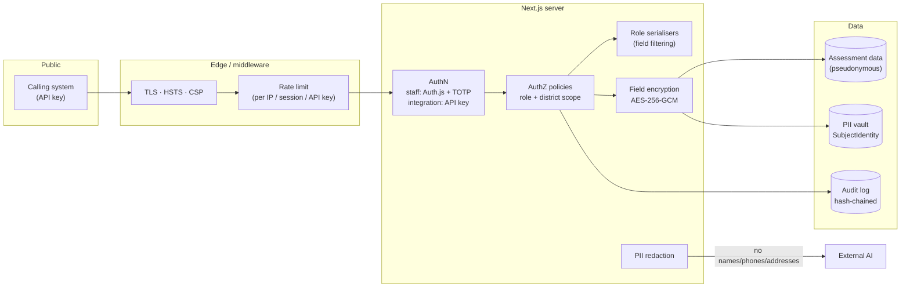

| Concern | Design | Requirement |
|---|---|---|
| Staff authentication | Auth.js v5 credentials + TOTP (mandatory for supervisor/admin roles), 15-minute idle timeout, rotating JWT session. | NFR-SEC-02/03 |
| Integration authentication | `Authorization: ApiKey <prefix>.<secret>`; hash stored; scopes; per-key rate limit. | FR-API-02 |
| Authorisation | `can(user, action, resource)` policy table (see `API_CONTRACTS.md` §4), always applied server-side, plus district scoping for district/police/welfare roles. | NFR-PRI-02 |
| Field filtering | Per-role DTO serialisers. Police and welfare serialisers have **no code path** to narrative, indicators or SVI. | C-ETH-02, AC-DSH-01 |
| Encryption at rest | Columns ending in `Enc` hold AES-256-GCM ciphertext with a key ID prefix (key rotation); DB and object storage also encrypted by the provider. | NFR-SEC-01 |
| PII separation | `subject_identities` holds the only copy of name, phone and address, on a **separate Mongoose connection** (`MONGODB_PII_URI`, its own DB user and encryption key); everything else references the pseudonymous `subjects._id`. | NFR-PRI-03 |
| Third-party AI | Redaction before every external call; providers with no-training / zero-retention settings where available. | NFR-SEC-05, NFR-PRI-06 |
| Audio | Processed in memory and dropped; stored only with `audioRetention` consent, encrypted, with `deleteAfter`. | FR-VOI-09 |
| Retention | **TTL indexes** on `messages.purgeAt` and `voice_windows.purgeAt` delete content automatically; the `retention.purge` job clears evidence quotes in `indicators`, summaries and notes, and deletes stored audio files before their documents; `daily_stats` aggregates survive. | NFR-PRI-04 |
| Analytics privacy | Analytics queries run on aggregate views; cells with count < 5 are suppressed in the aggregation pipeline (`$match: { count: { $gte: 5 } }`). | FR-DSH-06 |
| Logging | Structured logs contain IDs and error codes only, never message text. | NFR-REL-03 |
| Web security | Zod validation on every input, CSRF protection (SameSite + origin check), strict CSP, no secrets in client bundles, dependency scanning. | NFR-SEC-04 |

---

## 10. Real-time, jobs and failure handling

### 10.1 Real-time channels (Pusher)
| Channel | Who can subscribe | Events |
|---|---|---|
| `private-interaction-{id}` | Assigned operator/counsellor, supervisors | `transcript.appended`, `assessment.updated`, `emergency.show` |
| `private-queue-{districtId}` / `private-queue-national` | Counsellors, operators, supervisors in scope | `case.updated`, `case.created` |
| `private-oncall` | On-duty counsellors | `alert.created`, `alert.acknowledged` |
| `private-supervisors` | NHAA supervisors | `alert.escalated` |
| `private-role-{ROLE}-{districtId}` | District officer, police liaison, welfare officer | `referral.created`, `referral.updated` |

Channel authorisation goes through `POST /api/v1/realtime/auth`, which applies the same policies as the REST API. Payloads carry IDs plus role-safe summaries; clients fetch details over REST. Calling systems get live updates from `GET /api/v1/integration/interactions/{id}/stream` (SSE, scope `stream:read`).

### 10.2 Jobs
Jobs live in the `jobs` collection. There is no separate worker process: `core/jobs/runDue()` atomically claims and runs up to 5 due jobs, and is called (a) at the end of `GET /staff/alerts`, which every open staff dashboard polls every 10 s, and (b) from `POST /api/v1/internal/jobs/run` (protected by a secret) for manual or scripted runs. For local development `npm run jobs` calls the same function in a loop.

| Job type | Created when | Action |
|---|---|---|
| `alert.escalate` | Alert opened | If still OPEN: raise `escalationLevel`, notify the next tier, schedule the next escalation |
| `followup.remind` | High/Critical case closed with a follow-up | Notify the assignee when due |
| `retention.purge` | At most once a day (first request after midnight claims it) + on consent withdrawal | Clear evidence quotes, summaries and notes past retention; delete audio objects (messages and voice windows expire via TTL indexes) |
| `stats.rollup` | Hourly | Aggregate anonymised counts into `daily_stats` with `$merge` |
| `rescore` | Analysis degraded, or new active config | Re-run analysis/scoring and save a new snapshot (never lowers locked bands) |

### 10.3 Failure modes
| Failure | Behaviour |
|---|---|
| Analysis service down or slow | Lexicon + context scoring; `limitedConfidence`; `rescore` job; UI shows "Limited AI analysis" badge (NFR-REL-01) |
| Audio analysis fails | The window is skipped and marked; text already received keeps its scores (NFR-REL-02) |
| Pusher down | Staff UI polls `GET /alerts?status=OPEN` and the queue every 10 s |
| DB write fails mid-pipeline | Single multi-document transaction (`session.withTransaction`): nothing partial is saved; the client retries with the same `Idempotency-Key` |
| Calling system on a slow network | Small JSON responses; `Idempotency-Key` on messages so retries are safe |

---

## 11. Deployment

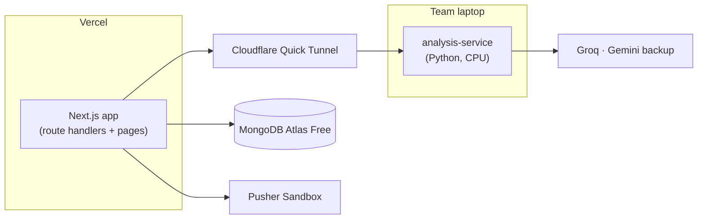

| Environment | Setup |
|---|---|
| **Local dev** | MongoDB Atlas Free (no Docker needed); `uvicorn app.main:app --port 8000` in `analysis-service/`; `npm run dev` in `web/`; optional `npm run jobs`; Pusher sandbox app or the local SSE fallback (`REALTIME_DRIVER=sse`). |
| **Staging** | Vercel Hobby (web) + MongoDB Atlas Free + Pusher Sandbox; analysis service on a team laptop exposed with `cloudflared tunnel --url http://localhost:8000` and the URL set as `ANALYSIS_URL`. Seeded with synthetic cases and seeded staff user for each role. All free (see `TOOLS_AND_COSTS.md`). |
| **Production (proposal for NHAA)** | Government cloud (MeghRaj / NIC) in India for data residency, MongoDB Enterprise or Atlas in an Indian region, PII vault in a separate cluster; analysis models self-hosted on GPU; Bhashini for languages; VPC-only traffic between services. |

**Environment variables (main):** web: `MONGODB_URI`, `MONGODB_PII_URI`, `ENCRYPTION_KEYS` (JSON of key ID → base64 key), `ENCRYPTION_ACTIVE_KEY`, `AUTH_SECRET`, `ANALYSIS_URL`, `ANALYSIS_HMAC_SECRET`, `PUSHER_APP_ID/KEY/SECRET/CLUSTER`, `JOBS_SECRET`. Analysis service: `ANALYSIS_HMAC_SECRET`, `GROQ_API_KEY`, `GEMINI_API_KEY`, `HF_TOKEN` (to download IndicConformer), optional `BHASHINI_USER_ID` / `BHASHINI_API_KEY`.

---

## 12. Tech stack

| Layer | Choice |
|---|---|
| Framework | **Next.js 16** (App Router), React, **TypeScript** (strict) |
| UI | Tailwind CSS + shadcn/ui; Recharts for dashboards; translated emergency options and operator questions in `messages/*.json` (en, hi, mr, ta, bn) |
| Validation and contracts | **Zod** schemas shared by routes and client; OpenAPI generated from Zod (`zod-to-openapi`) |
| Database | **MongoDB 8** (Atlas) + **Mongoose 9** (schemas, validation, indexes); Zod at the API boundary |
| Auth | Auth.js v5 (credentials + TOTP via `otplib`) for staff; API keys for integrations |
| Real-time | Pusher Channels (`pusher` server, `pusher-js` client); SSE fallback for local dev |
| Rate limiting | MongoDB-backed fixed-window counters (Upstash free tier optional) |
| Audio capture (Nivara portal) | MediaRecorder (opus/webm, 5 s timeslice); recorder logic kept in `components/audio/` for Speak on the portal |
| Languages | `next-intl` (installed): site language in the `NEXT_LOCALE` cookie, `src/i18n/request.ts`, all strings in `messages/*.json` (en default, hi, mr, ta, bn) |
| Analysis service | Python 3.12, FastAPI, Pydantic, `groq` SDK, silero-vad, praat-parselmouth, librosa, funasr (emotion2vec+), transformers (IndicConformer) |
| Testing | Vitest (unit, scoring), Playwright (E2E per role), pytest (analysis), k6 (latency checks) |
| Quality | ESLint, Prettier, Ruff, GitHub Actions CI |

> Versions checked 14 Nov 2026: Next.js 16.4.x and Mongoose 9.12.x are current; Auth.js v5 is still published as beta.

---

## 13. Repository structure

```
/
├── web/                                # Next.js app
│   ├── scripts/
│   │   ├── seed.ts                     # seeded staff user per role + synthetic cases
│   │   └── sync-indexes.ts             # Model.syncIndexes() for every model (run on deploy)
│   ├── messages/                       # every public, portal, login and staff string + emergency options + operator questions: en hi mr ta bn
│   ├── src/
│   │   ├── app/
│   │   │   ├── (public)/               # Phase P: home page (Start hero), start/ (before we begin, how to share), start/{write,speak}, track/[docket]
│   │   │   ├── (staff)/
│   │   │   │   ├── operator/           # live call console
│   │   │   │   ├── counsellor/         # queue, case/[id]
│   │   │   │   ├── district/
│   │   │   │   ├── police/
│   │   │   │   ├── welfare/
│   │   │   │   ├── analytics/          # state + ministry
│   │   │   │   ├── admin/              # users, scoring configs, audit
│   │   │   │   (the portal is the public site)
│   │   │   ├── api/portal/…              # public portal relay: calls /api/v1/integration with PORTAL_API_KEY behind the plan §7 safeguards (API_CONTRACTS §6.5)
│   │   │   └── api/v1/
│   │   │       ├── integration/…       # API-key API: the module's only input
│   │   │       ├── staff/…             # Auth.js session API
│   │   │       └── realtime/auth/
│   │   ├── core/
│   │   │   ├── interactions/           # start, consent, end, emergency copy, summary
│   │   │   ├── operator/               # suggested questions for the operator, and the next question for a calling system's chatbot
│   │   │   ├── consent/
│   │   │   ├── safety-lexicon/         # engine.ts + rules/{en,hi,hinglish,mr,ta,bn}.json
│   │   │   ├── scoring/                # fuse.ts svi.ts bands.ts overrides.ts explain.ts
│   │   │   ├── recommendations/
│   │   │   ├── cases/  alerts/  audit/
│   │   │   ├── privacy/                # redact.ts crypto.ts
│   │   │   ├── policies/               # rbac.ts serializers.ts
│   │   │   ├── analysis-client/
│   │   │   └── portal/                  # portal only: client, guard + public + limits (safeguards), districts
│   │   ├── components/                 # public/ (header, footer, track), portal/ (journey steps, consent, chat, microphone, review, registered), staff/, ui/, audio/
│   │   ├── i18n/                       # next-intl request config (site language from the NEXT_LOCALE cookie)
│   │   ├── contracts/                  # Zod schemas = API contracts
│   │   ├── lib/                        # db.ts (cached Mongoose connection), realtime.ts, ratelimit.ts
│   │   └── models/                     # Mongoose models (one file per collection)
│   ├── scripts/jobs.ts                # local loop calling core/jobs/runDue()
│   └── tests/{unit,e2e}/
├── analysis-service/                   # Python FastAPI
│   ├── app/{main.py, audio/, text/, models/, schemas.py}
│   ├── tests/
│   └── requirements.txt
├── evaluation/                         # synthetic scenario set + scripts (AC-EVAL-01)
│   ├── scenarios/*.json
│   ├── audio/
│   └── run_eval.ts                     # band accuracy, recall, fairness report
├── docs/                               # REQUIREMENTS, ARCHITECTURE, DATABASE, API_CONTRACTS, TOOLS_AND_COSTS, IMPLEMENTATION_PLAN
└── CLAUDE.md
```

---

## 14. Requirements coverage

| Requirement group | Where it lives |
|---|---|
| FR-CH (inputs) | `/api/v1/integration/*` (text, audio, context), `messages.sender`, operator console |
| FR-CON (consent) | `consent` module, `interactions.consents[]`, consent state on integration start, integration withdraw endpoint |
| FR-VOI (voice) | `/api/v1/integration/…/audio`, `/v1/analyze/audio`, `voice_windows`; speaker separation planned (Phase M) |
| FR-NLP, FR-EMO | `safety-lexicon`, `/v1/analyze/text`, `indicators`, guardrail validation |
| FR-IND, FR-SVI, FR-RISK | `scoring`, `indicators`, `assessments`, `scoring_configs`, `cases.bandOverrides` |
| FR-REC | `recommendations` module, `recommendations` + `referrals` collections |
| FR-LANG | `messages/*.json` (emergency options, operator questions), lexicon rules per language, LID/MT in the analysis service |
| FR-CASE, FR-ALR, FR-DSH | `cases`, `alerts`, staff pages, Pusher channels, in-request job runner |
| FR-API | `/api/v1/integration/*`, `api_clients` |
| FR-AUD | `audit` module, `audit_logs` |
| NFR-PRI, NFR-SEC | §9 |
| NFR-ETH | ADR-3, ADR-4, ADR-10, §8 rules, integration `/messages` response contract |
| NFR-PERF | §5 latency budget, §6.2 window budget |
| NFR-REL | §10.3 |
| NFR-MNT | ADR-2, ADR-4, repository structure, tests |
| NFR-ACC | Staff UI and the public pages (home, the portal journey, track, login): WCAG 2.1 AA, checked with axe in the e2e suite. Victim-facing screens of NHAA's systems belong to the calling system. |
