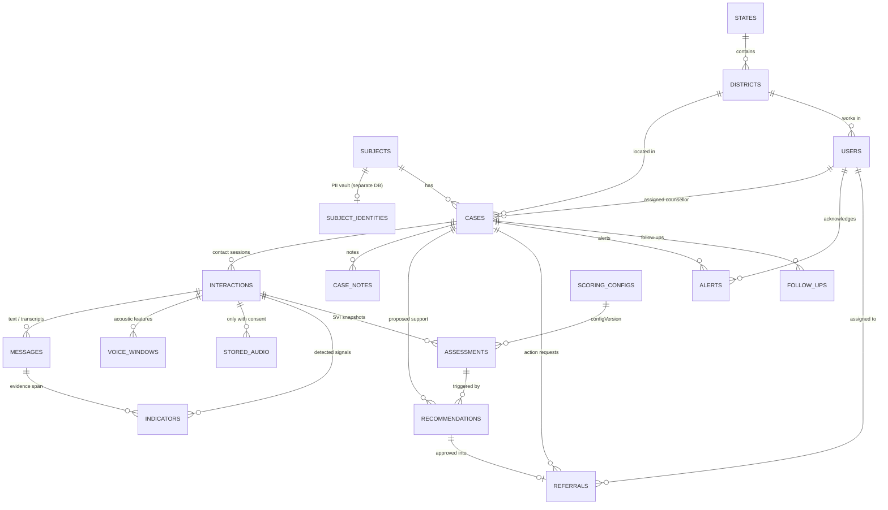

# Database Design (MongoDB)
## AI-Based Real-Time Stress and Trauma Assessment Module (SIH26093)

> The full Mongoose schema is in **`models.ts`** (type-checked with TypeScript strict mode, validation rules tested).
> Requirement IDs refer to `REQUIREMENTS.md`; architecture context is in `ARCHITECTURE.md`.

---

## Contents
1. [Setup and principles](#1-setup-and-principles)
2. [Collection map](#2-collection-map)
3. [Embed or reference?](#3-embed-or-reference)
4. [Collections](#4-collections)
5. [Example documents](#5-example-documents)
6. [Transactions: what is written together](#6-transactions-what-is-written-together)
7. [Key queries](#7-key-queries)
8. [Privacy: encryption, PII vault, retention](#8-privacy-encryption-pii-vault-retention)
9. [Audit hash chain](#9-audit-hash-chain)
10. [Operations: connection, indexes, seeding, local setup](#10-operations-connection-indexes-seeding-local-setup)

---

## 1. Setup and principles

| Topic | Decision |
|---|---|
| Server | **MongoDB 8**, always as a **replica set**: Atlas (free M0 for demo) or a single-node replica set locally. Needed for multi-document transactions and change streams. |
| ODM | **Mongoose 9** with TypeScript; schemas validate enums, ranges and required fields. **Zod** validates every API input before it reaches Mongoose. |
| Databases | `nhaa_assess` (everything) and `nhaa_pii` (only `subject_identities`) on separate connections and credentials (NFR-PRI-03). |
| IDs | `ObjectId` for every `_id`; the NHAA **docket number** is a separate unique field. |
| Pseudonymity | Every collection references the victim only through `subjects._id`. Name, phone and address exist only in `nhaa_pii.subject_identities`. |
| Encrypted fields | Fields ending in `Enc` (message text, translations, evidence quotes, summaries, notes, PII) hold application-level **AES-256-GCM** ciphertext with a key ID, so keys can be rotated (NFR-SEC-01). |
| Immutability | `assessments`, `messages`, `case_notes`, `audit_logs` and consent entries are **append-only**: the app never updates or deletes them except through retention. |
| Dates | Stored as UTC `Date`. |
| No caste field | No collection stores caste or community identity (C-ETH-03). |

---

## 2. Collection map



**Collections (22):**

| Group | Collections |
|---|---|
| Reference data | `states`, `districts` |
| People and access | `users`, `api_clients`, `subjects`, `subject_identities` (PII DB) |
| Case core | `cases`, `interactions` (embeds context, consents, latest-assessment head) |
| Raw signals | `messages`, `voice_windows`, `stored_audio` |
| Derived signals | `indicators`, `assessments`, `scoring_configs` |
| Response | `case_notes`, `recommendations`, `referrals`, `alerts`, `follow_ups` |
| Platform | `audit_logs`, `jobs`, `daily_stats` |

---

## 3. Embed or reference?

The rule: **embed** data that is small, bounded and always read with its parent; **reference** data that grows without limit, is read on its own, or needs different access control.

| Data | Choice | Why |
|---|---|---|
| Case context (offence type, age group, threats…) | **Embedded** in `interactions.context` | One small object, always read with the interaction |
| Consent entries | **Embedded array** in `interactions.consents` | A few entries per session; the latest is read on every request; append-only by convention |
| Latest SVI and band | **Embedded head** `interactions.current` + denormalised on `cases` | Queue sorting and dashboards without joins |
| Band overrides | **Embedded array** in `cases.bandOverrides` | Rare (a handful per case), always shown with the case |
| Messages, voice windows | **Separate collections** | Unbounded per interaction; need TTL deletion |
| Indicators, assessments | **Separate collections** | Many per interaction; queried by dimension and time; immutable history |
| Recommendations → referrals | **Separate collections** | Referrals are read by police/welfare roles, who must never load case content (C-ETH-02) |
| PII | **Separate database** | Strongest isolation (NFR-PRI-03) |

---

## 4. Collections

Legend: **🔒** = encrypted field, **TTL** = auto-deleted by MongoDB, **U** = unique index.

### 4.1 `cases`: one per docket number
| Field | Type | Notes |
|---|---|---|
| `docketNumber` | string **U** | NHAA docket (FR-CH-07) |
| `subjectId` | ObjectId → subjects | Pseudonymous victim |
| `stateId`, `districtId` | ObjectId | Scoping for district/state roles |
| `status` | enum | NEW → UNDER_REVIEW → ACTION_TAKEN → FOLLOW_UP_SCHEDULED → CLOSED (FR-CASE-05) |
| `assignedCounsellorId` | ObjectId → users | FR-CASE-02 |
| `currentBand`, `bandRank`, `currentSvi` | enum, 0–4, 0–100 | Copied from the latest assessment for the queue |
| `latestAssessmentId` | ObjectId → assessments | |
| `overrideLockedBand` | enum | The AI cannot set a band below this (FR-RISK-03) |
| `waitingSince` | Date | Reset when a responder acts; third sort key |
| `limitedConfidence` | bool | Latest score made in fallback mode |
| `summaryEnc` 🔒, `summaryTranslatedEnc` 🔒 | string | Neutral summary (FR-NLP-09) |
| `bandOverrides[]` | embedded | `{fromBand, toBand, reason (≥ 5 chars), byUserId, at}` |
| `firstContactAt`, `lastActivityAt`, `closedAt` | Date | |

**Indexes:** `{status:1, bandRank:-1, currentSvi:-1, waitingSince:1}` (queue) · `{districtId:1, status:1, bandRank:-1}` · `{assignedCounsellorId:1, status:1}` · `docketNumber` U · `subjectId`.

### 4.2 `interactions`: one per contact session
| Field | Type | Notes |
|---|---|---|
| `caseId`, `subjectId` | ObjectId | |
| `channel` | enum | PORTAL, CHATBOT, VOICE_CALL, IVRS, MOBILE_APP, OPERATOR_ASSISTED, API |
| `status` | enum | ACTIVE, ENDED, ABANDONED (timeout) |
| `mode` | enum | SAFETY_ONLY · TEXT_ONLY · VOICE_ONLY · FULL, derived from consent; default SAFETY_ONLY |
| `uiLanguage`, `detectedLanguages[]` | string | BCP-47 codes |
| `operatorId`, `apiClientId`, `districtId` | ObjectId | |
| `messageSeq`, `assessmentSeq` | number | Counters, incremented with `$inc` to number child documents |
| `voiceBaseline` | object | Speaker baseline (FR-VOI-03), from the caller's speech only |
| `speakerStateEnc` 🔒 | string | Encrypted voice fingerprints of the two speakers of a `MIXED` call (task M.10), so labels stay consistent across windows. Biometric: deleted when the interaction ends |
| `voiceUnseparated` | bool | A `MIXED` window could not be separated with confidence: every later assessment of this interaction is limited confidence (FR-VOI-10) |
| `context` | embedded | Optional case details from NHAA's record (FR-CH-08) |
| `consents[]` | embedded | `{action, noticeVersion, language, textAnalysis, voiceAnalysis, shareWithCounsellor, followUpContact, audioRetention, guardianConsent, at}` |
| `current` | embedded | `{assessmentId, svi, band, confidence, at}` |
| `startedAt`, `endedAt`, `retentionUntil` | Date | |

**Indexes:** `caseId` · `{status:1, startedAt:-1}`.

*Removed 16 Nov 2026 (`PRODUCT_VISION.md` §5): `sessionTokenHash`, `sessionExpiresAt`, `flowState`, `screenerResponses[]`, `screenerScores[]` (no victim session, no question flow, no screeners). `scripts/drop-screener-data.ts` removes them from existing synthetic documents; drop the old `sessionTokenHash_1` index with `npm run db:indexes`.*

### 4.3 `messages`
| Field | Type | Notes |
|---|---|---|
| `interactionId`, `seq` | ObjectId, number | **U** together |
| `sender` | enum | VICTIM (the person; scored), OPERATOR (NHAA's chatbot or operator; stored as context, never scored), SYSTEM (legacy scripted prompts; no longer written) |
| `modality` | enum | TEXT, VOICE_TRANSCRIPT (`IVR_KEYPRESS` removed 16 Nov 2026) |
| `textEnc` 🔒 | string | Original text or transcript |
| `translationEnc` 🔒 | string | EN/HI for responders (FR-LANG-06) |
| `language`, `sttConfidence` | | |
| `idempotencyKey` | string | Partial **U** with `interactionId`, so retries over slow networks never duplicate |
| `purgeAt` | Date **TTL** | Retention (NFR-PRI-04) |

### 4.4 `voice_windows`: features only, never raw audio
`interactionId`, `windowIndex` (**U** together), `startMs`, `endMs`, `messageId` (transcript), `pauses {count, meanMs, maxMs, silenceRatio}`, `pitch {meanHz, stdHz, rangeHz}`, `speechRateWpm`, `energy {meanDb, deltaDb}`, `voiceQuality {jitter, shimmer}`, `events[] {type: CRYING|SOBBING|SIGH|LONG_SILENCE|SHARP_BREATH, startMs, endMs, confidence}`, `baselineDeviation`, `emotion {label, confidence, distribution}`, `modelVersion`, `purgeAt` **TTL**.

Since task M.10: `audioSource` (`CALLER_ONLY` | `MIXED`) and `speakers {separated, confident, callerMs, operatorMs}`. Features are computed from the caller's speech only; nothing identifying the voice is stored per window.

### 4.5 `stored_audio`: only with `audioRetention` consent
`interactionId`, `storageKey` (encrypted object in S3-compatible storage), `durationMs`, `deleteAfter`. No TTL index: the worker deletes the **object first, then the document**, so no orphaned files remain.

### 4.6 `indicators`
| Field | Type | Notes |
|---|---|---|
| `interactionId`, `caseId` | ObjectId | |
| `dimension` | enum (8) | ACUTE_STRESS, SEVERE_TRAUMA, FEAR_ANXIETY, DEPRESSION, SUICIDAL_IDEATION, INTIMIDATION, SOCIAL_ISOLATION, EXTREME_VULNERABILITY |
| `source` | enum | TEXT_NLP, SAFETY_LEXICON, VOICE, CONTEXT (`SCREENER` removed in config v3) |
| `score`, `confidence` | 0–1 | Validated range |
| `evidence` | embedded | `{type, messageId, spanStart, spanEnd, quoteEnc 🔒, voiceWindowId, eventType, contextField}` |
| `negated` | bool | Stored for audit, excluded from scoring (FR-NLP-08) |
| `modelVersion` | string | |
| `status` | enum | ACTIVE, CONFIRMED, REJECTED, ADJUSTED (FR-IND-05) |
| `review` | embedded | `{score, reason, byUserId, at}`; the original `score` is never overwritten |

**Indexes:** `{interactionId:1, dimension:1, status:1}` · `{caseId:1, createdAt:-1}`.

### 4.7 `assessments`: immutable SVI snapshots
| Field | Type | Notes |
|---|---|---|
| `interactionId`, `caseId`, `seq` | | `{interactionId, seq}` **U** |
| `trigger` | enum | TEXT_MESSAGE, VOICE_WINDOW, CONTEXT_UPDATE, INDICATOR_REVIEW, CONFIG_RESCORE |
| `svi` | 0–100 | FR-SVI-01 |
| `computedBand` / `band` | enum | Before / after safety overrides |
| `overridesFired[]` | string | e.g. `["OV-1"]` |
| `dimensions` | Map\<Dimension, {score, confidence, bySource, contribution}\> | Contributions sum to the SVI ±1 (AC-SVI-03) |
| `confidence`, `limitedConfidence` | | FR-SVI-04, NFR-REL-01 |
| `topEvidence[]` | `{indicatorId, dimension, label}` | FR-SVI-03 |
| `explanation` | string | Plain-language reason (FR-RISK-04) |
| `configVersion`, `modelVersions` | | Reproducibility (FR-SVI-07) |

### 4.8 `scoring_configs`
`version` **U**, `dimensionWeights` (Map, sums to 1), `sourceWeights`, `voiceOnlyCap` (0.6), `bandThresholds {moderate, high, critical}`, `safetyOverrides` (REQUIREMENTS Appendix B), `recommendationRules` (Appendix C), `alertPolicy {criticalAckTimeoutSec, escalationChain}`, `isActive` (partial **U**, so only one config can be active), `notes`, `createdById`.

### 4.9 `recommendations`
`caseId`, `interactionId`, `assessmentId`, `type` (COUNSELLING, LEGAL_AID, MEDICAL_ASSISTANCE, POLICE_INTERVENTION, WITNESS_PROTECTION, EMERGENCY_SUPPORT, REHABILITATION_RELIEF, INFORMATION), `ruleId`, `reason`, `urgency`, `dueAt`, `responsibleRole`, `legalBasis`, `status` (PROPOSED, APPROVED, REJECTED, AUTO_TRIGGERED, SUPERSEDED), `decision {byUserId, at, reason}`, `postReviewedAt`, `referralId`.
**Indexes:** `{caseId:1, type:1, status:1}` · `{status:1, responsibleRole:1, dueAt:1}` (approval inbox).

### 4.10 `referrals`: the only case data police and welfare see
`recommendationId` **U**, `caseId`, `docketNumber`, `type`, `targetRole`, `districtId`, `assignedToId`, `actionRequested`, `locationHint` (village/ward, never a full address), `contactRoute`, `urgency`, `dueAt`, `status`, `outcomeNote`, `declinedReason`, `history[] {status, byUserId, at}`.
**Index:** `{targetRole:1, districtId:1, status:1, dueAt:1}`.

### 4.11 `alerts`
`caseId`, `interactionId`, `level` (CRITICAL, HIGH), `reason`, `status` (OPEN, ACKNOWLEDGED, RESOLVED), `escalationLevel` (0 counsellors → 1 supervisor → 2 district), `escalateAt`, `acknowledgedById`, `acknowledgedAt`, `resolvedAt`.
**Indexes:** `{status:1, escalateAt:1}` (worker) · `{caseId:1, level:1}` **unique where status = OPEN**, so a case can never get duplicate open alerts.

### 4.12 Other collections
| Collection | Key fields | Indexes |
|---|---|---|
| `users` | `email` U, `passwordHash` (hidden), `role`, `stateId`, `districtId`, `languages[]`, `totpSecretEnc` 🔒 (hidden), `isActive`, `isOnDuty`, `openCaseCount` | `{role, districtId, isOnDuty}` |
| `api_clients` | `keyPrefix` U, `keyHash` (hidden), `scopes[]`, `rateLimitPerMin`, `isActive` | |
| `subjects` | `_id`, `createdAt` only | |
| `subject_identities` (PII DB) | `_id` = subject id, `fullNameEnc` 🔒, `phoneEnc` 🔒, `phoneHash` (HMAC, for de-duplication), `addressEnc` 🔒 | `phoneHash` |
| `case_notes` | `caseId`, `authorId`, `bodyEnc` 🔒 | `{caseId, createdAt:-1}` |
| `follow_ups` | `caseId`, `dueAt`, `channel`, `status`, `assignedToId`, `outcomeNote` | `{status, dueAt}` |
| `rate_limits` | `key` (SHA-256 of scope + subject; never a raw IP), `windowStart`, `count`, `expiresAt` | `{key, windowStart}` U, **TTL** on `expiresAt` |
| `audit_logs` | `actorType`, `actorId`, `action`, `entityType`, `entityId`, `metadata` (never content), `ipHash`, `prevHash` U, `hash` U | `{entityType, entityId, createdAt}`, `{actorId, createdAt}` |
| `jobs` | `type`, `payload`, `runAt`, `attempts`, `lockedUntil`, `doneAt`, `lastError`, `cleanupAt` **TTL** | `{doneAt, runAt}` |
| `daily_stats` | `day`, `stateId`, `districtId`, `channel`, `language`, `band`, counts, median times, referral counts by type | U on the full dimension key |
| `states`, `districts` | `code` U, `name`, `stateId` | |

---

## 5. Example documents

### `cases`
```json
{
  "_id": "6735a1f0c2a4b1e0f0a10001",
  "docketNumber": "NHAA-2026-MH-004512",
  "subjectId": "6735a1f0c2a4b1e0f0a1aaaa",
  "stateId": "6735a1f0c2a4b1e0f0a1s001",
  "districtId": "6735a1f0c2a4b1e0f0a1d017",
  "status": "UNDER_REVIEW",
  "assignedCounsellorId": "6735a1f0c2a4b1e0f0a1u042",
  "currentBand": "CRITICAL",
  "bandRank": 4,
  "currentSvi": 81,
  "latestAssessmentId": "6735a1f0c2a4b1e0f0a1as07",
  "overrideLockedBand": "CRITICAL",
  "waitingSince": "2026-11-14T11:32:05Z",
  "limitedConfidence": false,
  "summaryEnc": "enc:v1:k2:…",
  "bandOverrides": [],
  "firstContactAt": "2026-11-14T11:28:40Z",
  "lastActivityAt": "2026-11-14T11:33:12Z"
}
```

### `interactions` (embedded parts shown)
```json
{
  "_id": "6735a1f0c2a4b1e0f0a1in01",
  "caseId": "6735a1f0c2a4b1e0f0a10001",
  "channel": "CHATBOT",
  "status": "ACTIVE",
  "mode": "FULL",
  "uiLanguage": "hi",
  "detectedLanguages": ["hi", "hi-Latn"],
  "messageSeq": 9,
  "assessmentSeq": 7,
  "context": { "isSexualOffence": false, "ongoingThreats": true, "accusedNearby": true, "supportPersonPresent": false },
  "consents": [
    { "action": "GRANTED", "noticeVersion": "2026-11-v1", "language": "hi",
      "textAnalysis": true, "voiceAnalysis": true, "shareWithCounsellor": true,
      "followUpContact": true, "audioRetention": false, "at": "2026-11-14T11:28:55Z" }
  ],
  "current": { "assessmentId": "6735a1f0c2a4b1e0f0a1as07", "svi": 81, "band": "CRITICAL", "confidence": 0.78 }
}
```

### `assessments`
```json
{
  "_id": "6735a1f0c2a4b1e0f0a1as07",
  "interactionId": "6735a1f0c2a4b1e0f0a1in01",
  "caseId": "6735a1f0c2a4b1e0f0a10001",
  "seq": 7,
  "trigger": "TEXT_MESSAGE",
  "svi": 81,
  "computedBand": "CRITICAL",
  "band": "CRITICAL",
  "overridesFired": ["OV-2"],
  "dimensions": {
    "INTIMIDATION":          { "score": 0.95, "confidence": 0.9,  "bySource": { "TEXT_NLP": 0.95, "CONTEXT": 1.0 }, "contribution": 14.3 },
    "FEAR_ANXIETY":          { "score": 0.85, "confidence": 0.8,  "bySource": { "TEXT_NLP": 0.8, "VOICE": 0.7 },   "contribution": 10.2 },
    "SUICIDAL_IDEATION":     { "score": 0.4,  "confidence": 0.7,  "bySource": { "TEXT_NLP": 0.4 },               "contribution": 8.0 },
    "EXTREME_VULNERABILITY": { "score": 0.9,  "confidence": 0.95, "bySource": { "CONTEXT": 0.9 },                "contribution": 10.8 }
  },
  "confidence": 0.78,
  "limitedConfidence": false,
  "topEvidence": [
    { "indicatorId": "…", "dimension": "INTIMIDATION", "label": "Reports the accused is outside the house now" }
  ],
  "explanation": "Critical: caller reports the accused is outside the house now (OV-2); high fear and threats.",
  "configVersion": 3,
  "modelVersions": { "nlp": "llm-indicators@2026-11-01", "lexicon": "hi-1.4", "voice": "ser-w2v2@1.0" },
  "createdAt": "2026-11-14T11:33:12Z"
}
```
*(Only 4 of the 8 dimensions are shown; real documents always contain all 8.)*

### `referrals` (police view: no narrative, no SVI)
```json
{
  "_id": "6735a1f0c2a4b1e0f0a1rf03",
  "docketNumber": "NHAA-2026-MH-004512",
  "type": "POLICE_INTERVENTION",
  "targetRole": "POLICE_LIAISON",
  "districtId": "6735a1f0c2a4b1e0f0a1d017",
  "actionRequested": "Urgent protection visit; complainant reports threats at residence",
  "locationHint": "Ward 7, Village X",
  "contactRoute": "Via NHAA desk, quote docket NHAA-2026-MH-004512",
  "urgency": "IMMEDIATE",
  "status": "PENDING"
}
```

---

## 6. Transactions: what is written together

All writes in one pipeline run happen in **one multi-document transaction** (`session.withTransaction`), so dashboards never see half-finished state, and a retry with the same `Idempotency-Key` is safe.

| Pipeline run (e.g. new text message) | Collections written |
|---|---|
| Store the message | `interactions` (`$inc messageSeq`), `messages` |
| Store indicators | `indicators` |
| Save the snapshot | `interactions` (`$inc assessmentSeq`, set `current`), `assessments` |
| Update queue fields | `cases` (`currentBand`, `bandRank`, `currentSvi`, `overrideLockedBand`, `lastActivityAt`) |
| Recommendations | `recommendations` (insert new, mark old SUPERSEDED) |
| Alert on band rise | `alerts` (upsert OPEN), `jobs` (`alert.escalate`) |
| Audit | `audit_logs` |

Real-time events are published **after commit** (never inside the transaction), so staff never see an update that was rolled back.

```ts
// src/core/pipeline/commit.ts (sketch)
await session.withTransaction(async () => {
  const { messageSeq } = await Interaction.findByIdAndUpdate(
    interactionId, { $inc: { messageSeq: 1 } }, { session, new: true });
  await Message.create([{ interactionId, seq: messageSeq, /* … */ }], { session });
  await Indicator.insertMany(indicators, { session });
  // … assessment, case, recommendations, alert, audit
}, { readConcern: { level: "snapshot" }, writeConcern: { w: "majority" } });
await realtime.publish(events); // after commit
```

---

## 7. Key queries

### 7.1 Risk-sorted counsellor queue (FR-CASE-01, AC-CASE-01)
```ts
Case.find({ status: { $ne: "CLOSED" }, districtId: { $in: scope.districtIds } })
  .sort({ bandRank: -1, currentSvi: -1, waitingSince: 1 })
  .select("docketNumber currentBand currentSvi status assignedCounsellorId waitingSince limitedConfidence")
  .limit(50);
```
Served by the index `{districtId, status, bandRank}` for district-scoped users, and `{status, bandRank, currentSvi, waitingSince}` for national users.

### 7.2 Fusion input for the scoring engine
```ts
Indicator.find({ interactionId, status: { $ne: "REJECTED" }, negated: false })
  .select("dimension source score confidence status review evidence.type")
  .lean();
```

### 7.3 Worker: claim a due job atomically
```ts
Job.findOneAndUpdate(
  { doneAt: null, runAt: { $lte: now }, $or: [{ lockedUntil: null }, { lockedUntil: { $lt: now } }] },
  { $set: { lockedUntil: new Date(now.getTime() + 60_000) }, $inc: { attempts: 1 } },
  { sort: { runAt: 1 }, new: true },
);
```

### 7.4 Anonymised analytics with small-count suppression (FR-DSH-06, AC-DSH-02)
```ts
DailyStat.aggregate([
  { $match: { stateId, day: { $gte: from, $lte: to } } },
  { $group: { _id: { districtId: "$districtId", band: "$band" }, count: { $sum: "$interactions" } } },
  { $match: { count: { $gte: 5 } } },            // suppress cells below 5
  { $lookup: { from: "districts", localField: "_id.districtId", foreignField: "_id", as: "d" } },
  { $project: { _id: 0, district: { $first: "$d.name" }, band: "$_id.band", count: 1 } },
]);
```
`daily_stats` is filled hourly by the `stats.rollup` job, using an aggregation over `interactions`, `alerts` and `referrals` that ends in `$merge`. Analytics roles never query case collections directly.

---

## 8. Privacy: encryption, PII vault, retention

### 8.1 Field encryption
```ts
// src/core/privacy/crypto.ts (sketch)
// Format: enc:v1:<keyId>:<iv b64>:<tag b64>:<ciphertext b64>
encrypt(plain: string): string      // AES-256-GCM, random 12-byte IV, current key
decrypt(token: string): string      // picks the key by keyId, so rotation needs no downtime
```
Keys come from `ENCRYPTION_KEYS` (JSON `{ "k1": "<base64>", "k2": "…" }`) with `ENCRYPTION_ACTIVE_KEY=k2`. A rotation job re-encrypts old values in batches.

> **Production option:** MongoDB **Client-Side Field Level Encryption / Queryable Encryption** with a KMS can replace the application-level helper. The `…Enc` field names stay the same.

### 8.2 PII vault
- `subject_identities` lives in `nhaa_pii` on its own connection (`MONGODB_PII_URI`) with a separate DB user that only the intake service code path uses.
- Only roles with a real need (NHAA supervisor, assigned counsellor with `shareWithCounsellor` consent) can trigger a decrypted read, and every read is audited (`identity.view`).

### 8.3 Retention (NFR-PRI-04)
| Data | Mechanism | Default |
|---|---|---|
| `messages`, `voice_windows` | **TTL index** on `purgeAt` (set to `interaction.endedAt + retention`) | 365 days |
| Raw audio | Never stored; with consent, `stored_audio.deleteAfter` → worker deletes the object, then the document | 30 days |
| `indicators.evidence.quoteEnc`, case summaries, notes | `retention.purge` job sets them to `null` (the indicator itself stays, for score history) | 365 days |
| `assessments`, `alerts`, `referrals` | Kept: they contain no free text from the victim | Per policy |
| On consent withdrawal | Immediate: `stored_audio` deleted, `mode = SAFETY_ONLY`; further content kept only if needed for the complaint | Immediate |
| `jobs` | TTL on `cleanupAt` | 7 days after completion |

---

## 9. Audit hash chain

Each entry stores `prevHash` and `hash = sha256(prevHash + canonicalJSON(entry))`. **`prevHash` has a unique index**, so two writers can never both attach to the same previous entry: the chain cannot fork.

```ts
// src/core/audit/record.ts (sketch)
for (let attempt = 0; attempt < 5; attempt++) {
  const head = await AuditLog.findOne().sort({ _id: -1 }).select("hash").session(session);
  const prevHash = head?.hash ?? "GENESIS";
  const entry = { actorType, actorId, action, entityType, entityId, metadata, ipHash };
  const hash = sha256(prevHash + canonicalJson(entry));
  try {
    await AuditLog.create([{ ...entry, prevHash, hash }], { session });
    return;
  } catch (e) {
    if (isDuplicateKey(e, "prevHash")) continue; // another writer won: re-read head and retry
    throw e;
  }
}
```
`GET /api/v1/staff/admin/audit/verify` walks the chain and reports the first broken link, if any (FR-AUD-03).

---

## 10. Operations: connection, indexes, seeding, local setup

### 10.1 Cached connection for Next.js (serverless-safe)
```ts
// src/lib/db.ts
import mongoose from "mongoose";

const g = globalThis as unknown as { _mongo?: Promise<typeof mongoose> };

export function db() {
  g._mongo ??= mongoose.connect(process.env.MONGODB_URI!, {
    dbName: "nhaa_assess",
    maxPoolSize: 10,
    serverSelectionTimeoutMS: 5_000,
  });
  return g._mongo;
}
// The PII vault uses mongoose.createConnection(process.env.MONGODB_PII_URI!) in src/lib/pii-db.ts
```

### 10.2 Indexes
- `autoIndex: false` in production; `scripts/sync-indexes.ts` runs `Model.syncIndexes()` for every model at deploy time.
- TTL indexes are part of the same sync.

### 10.3 Optional: local replica set with Docker
The project uses Atlas Free for development (no Docker needed). Use this only if the team wants an offline database.
```yaml
services:
  mongo:
    image: mongo:8
    command: ["--replSet", "rs0", "--bind_ip_all"]
    ports: ["27017:27017"]
    healthcheck:
      test: ["CMD", "mongosh", "--quiet", "--eval",
             "try { rs.status().ok } catch (e) { rs.initiate({_id:'rs0',members:[{_id:0,host:'localhost:27017'}]}).ok }"]
      interval: 5s
      retries: 10
# MONGODB_URI=mongodb://localhost:27017/?replicaSet=rs0
```

### 10.4 Seeding (`scripts/seed.ts`)
- States and districts (a small subset, e.g. Maharashtra, Tamil Nadu, West Bengal, Uttar Pradesh)
- One demo user per role, with a known password and TOTP disabled in the demo environment only
- Scoring config v1 (weights, thresholds, overrides, rules from REQUIREMENTS appendices), active
- 20+ synthetic cases across all bands, channels and languages (from `evaluation/scenarios`)
- One API client for the integration demo

### 10.5 Size estimate (for sizing Atlas)
| Per interaction (typical 10-minute session) | Approx. |
|---|---|
| 1 interaction document | 6 KB |
| ~30 messages | 30 × 1.5 KB = 45 KB |
| ~60 voice windows (voice calls) | 60 × 1 KB = 60 KB |
| ~80 indicators | 80 × 0.6 KB = 48 KB |
| ~30 assessments | 30 × 2 KB = 60 KB |
| **Total** | **~220 KB** → the 512 MB free tier holds ~2,000 demo sessions |
